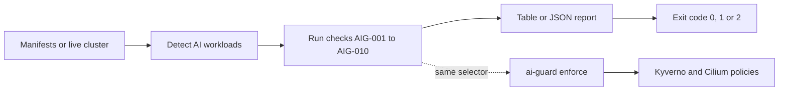

# ai-guard-k8s: find and fix unsafe settings in Kubernetes AI inference workloads

Scan manifests or a live cluster for unsafe settings in vLLM, Ollama, Triton, TGI and Ray Serve workloads. Then generate Kyverno and Cilium policies to harden them.

[](https://github.com/sv222/ai-guard-k8s/actions/workflows/ci.yml)
[](LICENSE)

`ai-guard` is a small Go CLI. It reads Kubernetes objects only. It does not scan prompts or model weights. It gives table or JSON output and exit codes for CI.

Platforms: Linux, macOS and Windows, on amd64 and arm64.

## Why this exists

- vLLM checks API keys only when you set `--api-key` or `VLLM_API_KEY`. Even then, the key covers only some URL paths ([vLLM security docs](https://docs.vllm.ai/en/stable/usage/security)).
- Ollama has no built-in authentication. It listens on localhost by default, and people change `OLLAMA_HOST` to reach it from other pods ([Ollama FAQ](https://docs.ollama.com/faq)).
- Inference pods are easy to deploy with root, `hostNetwork`, `hostPath` or a `LoadBalancer` Service. Each one widens who can reach the model or the node.
- Model loading can run code. `--trust-remote-code` runs Python from the model repository. Pickle formats (`.bin`, `.pt`, `.pkl`) can run code when loaded.

These are settings in the pod spec. A scan can find them before the pod runs.

## Demo in 30 seconds

Build the tool, then scan the sample manifests in this repo. Output is shortened: the evidence column and some rows are removed.

```
$ ai-guard scan --path testdata/manifests/offending
ID       SEVERITY  WORKLOAD                   TITLE
AIG-001  High      Deployment/bad/vllm-bad    vLLM without API key auth
AIG-003  High      Deployment/bad/vllm-bad    hostNetwork enabled
AIG-004  High      Deployment/bad/vllm-bad    hostPath volume
AIG-005  High      Deployment/bad/vllm-bad    privileged container
AIG-008  High      Deployment/bad/vllm-bad    --trust-remote-code enabled
AIG-008  High      Deployment/bad/vllm-bad    non-SafeTensors model reference
AIG-010  High      Deployment/bad/vllm-bad    inference exposed via NodePort
AIG-001  Medium    Deployment/bad/ollama-bad  Inference engine without engine/gateway auth evidence
AIG-009  Medium    Deployment/bad/ollama-bad  no NetworkPolicy isolation
...
$ echo $?
1

$ ai-guard scan --path testdata/manifests/clean
No findings.
$ echo $?
0
```

The full scan of the offending sample prints 22 findings: 12 High, 8 Medium and 2 Low. A path that does not exist gives exit code 2.

## Install

Download the archive for your system from the [Releases page](https://github.com/sv222/ai-guard-k8s/releases). Files are named `ai-guard_<version>_<os>_<arch>.tar.gz`, or `.zip` on Windows. Check the file with `checksums.txt`, then put `ai-guard` in your `PATH`.

With Go, or from source:

    go install github.com/sv222/ai-guard-k8s@latest

    git clone https://github.com/sv222/ai-guard-k8s.git
    cd ai-guard-k8s && make build && ./ai-guard --version

## Usage

    ai-guard scan --path manifests/            # files only, no cluster access
    ai-guard scan                              # live cluster from kubeconfig or KUBECONFIG
    ai-guard scan -n llm                       # one namespace
    ai-guard scan --path manifests/ --cluster  # files and cluster together
    ai-guard scan --path manifests/ --json     # JSON output

`--path` reads `.yaml`, `.yml` and `.json` files, including multi-document files and `kind: List`. Render Helm charts first with `helm template`.

| Exit code | Meaning |
|---|---|
| 0 | no finding at or above `--fail-on` |
| 1 | at least one finding at or above `--fail-on` |
| 2 | error: bad flag, unreadable path, cluster unreachable |

`--fail-on` accepts `low`, `medium` or `high`. The default is `low`.

## What it checks

A workload counts as AI inference if its name or an image contains `vllm`, `ollama`, `tritonserver`, `text-generation-inference`, `tgi` (whole word only), `ray-serve`, `text-embeddings-inference`, `local-ai`, `localai`, `sglang`, `llama.cpp`, `llama-cpp`, `lmdeploy` or `tensorrt-llm`. A container whose `command` or `args` start an engine also counts, for example `vllm serve`, `python -m vllm.entrypoints...` or `exec ollama serve`. You can also set the label or annotation `ai.infra.guard/enabled: "true"`, or pass `--workload-selector tier=inference`.

| ID | Risk | Severity | How it is detected | Fix | Maps to |
|---|---|---|---|---|---|
| AIG-001 | No auth on the engine | High (vLLM), Medium (others) | No `--api-key` arg, no `VLLM_API_KEY`, `API_KEY` or `OPENAI_API_KEY` env, and no `envFrom` Secret named like api-key, api-token, auth or bearer (names with hf, aws, s3, registry or tls do not count) | Set an API key, or annotate `ai.infra.guard/gateway-auth: "true"` if a gateway authenticates | - |
| AIG-002 | Debug or insecure endpoint | Medium | `--debug`, `--allow-http`, or `OLLAMA_DEBUG` set to `true` or `1` | Remove it | - |
| AIG-003 | Host namespaces | High | `hostNetwork` or `hostPID` is true | Set both to false | PSS Baseline: Host Namespaces (`hostIPC` is not checked) |
| AIG-004 | `hostPath` volume | High | Any `hostPath` volume | Use a PVC or `emptyDir` | PSS Baseline: HostPath Volumes |
| AIG-005 | Root, privileged, privilege escalation | High | Effective `runAsUser: 0`, `runAsNonRoot` not `true`, `privileged: true`, `allowPrivilegeEscalation` unset or true | Set `runAsNonRoot: true`, `privileged: false`, `allowPrivilegeEscalation: false` | PSS Restricted: Running as Non-root, Running as Non-root user, Privilege Escalation. Baseline: Privileged Containers |
| AIG-006 | Seccomp missing or `Unconfined` | Medium | Effective `seccompProfile` is unset or `Unconfined` | Set `RuntimeDefault` | PSS Restricted: Seccomp |
| AIG-007 | No resource requests or limits | Low | Missing `requests.memory`, `requests.cpu` or `limits.memory` | Set them | - |
| AIG-008 | Unsafe model execution | High (Medium for `s3://`, `gs://`) | `--trust-remote-code`; model args or env ending in `.bin`, `.pt`, `.pth`, `.pkl`, `.pickle`, `.ckpt`; `s3://` or `gs://` sources | Remove the flag, use SafeTensors, pin model provenance | OWASP LLM03:2025 Supply Chain; MITRE ATLAS AML.T0010 AI Supply Chain Compromise |
| AIG-009 | No NetworkPolicy isolation | Medium | No NetworkPolicy selects the pod and restricts traffic, or the policy allows all | Default-deny plus an allowlist (see `ai-guard enforce`) | - |
| AIG-010 | Exposed by `LoadBalancer`, `NodePort` or Ingress | High | A Service of that type selects the workload, or an Ingress routes to a Service that does, and no auth evidence exists. Ingress auth annotations (`auth-url`, `auth-type`, `auth-signin`, `auth-secret`, `oauth2`) or `ai.infra.guard/gateway-auth: "true"` on the Ingress count as auth | Add auth, use the gateway annotation, or use an internal Service | - |

Helm test hook pods (`helm.sh/hook: test`) are skipped. If you opt in a pod with one container and no engine is recognized, that container gets the engine checks (AIG-001, AIG-002, AIG-008). AIG-005, AIG-006 and AIG-007 also cover init containers. Container settings override pod settings. There is no inline ignore comment. To silence a check, fix the cause.

PSS means [Pod Security Standards](https://kubernetes.io/docs/concepts/security/pod-security-standards/). The mapping shows which control covers the same setting. It does not mean ai-guard is a PSS validator. The OWASP and ATLAS IDs are references for AIG-008 only.

## Harden with one command

    ai-guard enforce --out policies-out/

This writes four files. The default output is also in [`policies/`](policies/).

- `aig-require-nonroot.yaml`, `aig-block-host-access.yaml`, `aig-require-resources.yaml`: Kyverno `ClusterPolicy`.
- `aig-cilium-egress-fqdn.yaml`: `CiliumNetworkPolicy` that allows DNS and model download hosts only.

Policies select pods with the label `ai.infra.guard/enabled: "true"`. Change this with `--selector team=llm,tier=gpu`. They skip `kube-system`, `kube-public` and `kube-node-lease`.

    ai-guard enforce --mode enforce                      # Kyverno blocks bad pods
    ai-guard enforce --allow-fqdn models.example.com     # add an egress host (repeatable)
    ai-guard enforce --apply --dry-run                   # print what would be applied, change nothing
    ai-guard enforce --apply -n llm                      # server-side apply; -n sets the Cilium policy namespace
    ai-guard enforce --apply --skip-cilium               # Kyverno policies only, for clusters without Cilium

The Cilium policy allows Hugging Face hosts by default, including the two-label storage hosts, because a Cilium `*` matches one label only. `--apply` needs the Kyverno and Cilium CRDs in the cluster. On a cluster without Cilium, add `--skip-cilium` to generate and apply only the three Kyverno policies.

Safety note:

- The default mode is `Audit`. Policies report violations and block nothing. Review the reports, then use `--mode enforce`.
- `--apply` uses server-side apply with force. It takes over fields of existing policies with the same names. Run `--dry-run` first.
- Egress allowlists can break model downloads. Test in a non-production namespace first.

## How it works



Design decisions:

1. **Static and read-only by default.** `scan` only lists objects. It never changes the cluster. Only `enforce --apply` writes, and only when you ask.
2. **Audit before Enforce.** Generated policies start in `Audit` so you see the impact before anything is blocked.
3. **Same selector for scan and policies.** Both use the label `ai.infra.guard/enabled`, so the pods you scan are the pods you harden.

## Use in CI

```yaml
name: ai-guard
on: [pull_request]
jobs:
  scan:
    runs-on: ubuntu-latest
    steps:
      - uses: actions/checkout@v4
      - uses: actions/setup-go@v5
        with:
          go-version: stable
      - run: go install github.com/sv222/ai-guard-k8s@latest
      - run: ai-guard scan --path manifests/ --fail-on high
```

## How it was tested

Unit tests run with `go test -race ./...` in CI. Line coverage (measured with Go 1.27): `cmd` 90.5%, `pkg/checks` 98.8%, `pkg/scanner` 97.8%. The lowest package is `pkg/target` at 76.2%.

Tests on a real kind cluster (Kubernetes 1.37):

- `scan --cluster` and `scan --path` gave identical findings for the same workloads.
- Kyverno 1.19.1 in Audit mode recorded violations. In Enforce mode it rejected the bad pod and admitted the hardened one. `kube-system` was excluded.
- Cilium 1.20.2 accepted the generated `CiliumNetworkPolicy`.

Not verified:

- Cilium DNS-based (FQDN) egress could not be demonstrated in the kind test environment. The policy is accepted, but allow and deny behavior for real hosts is untested.
- The tests above used small stand-in images. Real Ollama and vLLM containers were tested separately (see below).

### Hardened examples (tested on kind)

[`examples/hardened/ollama.yaml`](examples/hardened/ollama.yaml) and [`examples/hardened/vllm.yaml`](examples/hardened/vllm.yaml) are complete manifests: Namespace, Deployment, ClusterIP Service and an ingress NetworkPolicy (vLLM also has a Secret). `ai-guard scan --path examples/hardened` reports no findings. A unit test checks this in CI. Copy them and change the image tag, the model and the limits. The vLLM Secret holds a placeholder: replace `REPLACE_WITH_A_RANDOM_KEY` before you apply it.

Tested on 2026-10-14 on a single-node kind v0.33.0 cluster (Kubernetes 1.37.0, default kindnet CNI). The host had an Intel i7-4710HQ (AVX2 only, no AVX-512) and 12 GB RAM. Kyverno 1.19.1 ran with one admission controller. The policies came from `ai-guard enforce --apply --mode enforce --skip-cilium`.

| | Ollama | vLLM |
|---|---|---|
| Image | `ollama/ollama:0.40.4` | `vllm/vllm-openai-cpu:v0.31.0-x86_64` |
| Model | `qwen2.5:0.5b`, pulled inside the running pod | `facebook/opt-125m`, `--dtype=float32` |
| Scan | no findings | no findings |
| Admission | admitted, Ready, UID 10001 | admitted, Ready, UID 10001 |
| Inference | `/api/generate` and `/v1/chat/completions` answered through the Service in about 3 s | `/v1/completions` answered through the Service. The first request took about 2 minutes. Later requests took 0.5 s |
| Auth | none in the engine (by design) | `/v1/models` and `/v1/completions` gave 401 without a key and with a wrong key, 200 with the key |
| NetworkPolicy | a client pod without the allowed label timed out | same |

`ai-guard scan -n llm` on the live cluster also reported no findings for the running vLLM pod.

Both containers ran with `runAsNonRoot`, a non-zero UID, `allowPrivilegeEscalation: false`, `capabilities.drop: [ALL]`, `seccompProfile: RuntimeDefault` and `readOnlyRootFilesystem: true`. Writable paths are `emptyDir` volumes. Neither needed an exception.

What the engines needed to run this way:

- Ollama: `HOME=/data`, `OLLAMA_MODELS=/data/models` on an `emptyDir`, and `OLLAMA_HOST=0.0.0.0:11434`. The image runs as root by default and keeps its key and models under `/root/.ollama`.
- vLLM: `enableServiceLinks: false`. Without it, a Service named `vllm` injects `VLLM_PORT=tcp://<ip>:8000` into the pod and vLLM exits with `VLLM_PORT ... appears to be a URI`. The pod crash-looped until this was set. The same risk exists for any Service whose name makes a `VLLM_*` variable.
- vLLM: `HOME`, `HF_HOME`, `VLLM_CACHE_ROOT` and similar paths on an `emptyDir`, plus an `emptyDir` with `medium: Memory` on `/dev/shm`.
- The vLLM docs suggest `--cap-add SYS_NICE` and `seccomp=unconfined` for Docker. Neither was needed here. With `RuntimeDefault` the logs show `get_mempolicy` and `set_mempolicy` "Operation not permitted" warnings (NUMA binding is skipped) and no failure. The host had one NUMA node. Multi-socket hosts were not tested.
- The vLLM flags `--enforce-eager`, `--max-model-len=512`, `VLLM_CPU_KVCACHE_SPACE=1` and `VLLM_CPU_OMP_THREADS_BIND=nobind` keep memory low on a small host. I did not test which of them are required.
- The Ollama manifest sets `ai.infra.guard/gateway-auth: "true"`. Ollama has no auth, so without this annotation AIG-001 reports Medium. The annotation is the manifest author's claim that the NetworkPolicy limits clients. ai-guard cannot check it.

Bad variants were created as Deployments and as bare Pods in the same namespace with Kyverno in Enforce mode: root user, privileged, `hostNetwork: true`, and no resource limits. The same four variants were used with the Ollama image and with the vLLM image. Every bare Pod was rejected at admission, for example:

    admission webhook "validate.kyverno.svc-fail" denied the request:
    resource Pod/llm/ollama-bad-hostnetwork was blocked due to the following policies
    aig-block-host-access:
      block-host-access: 'validation error: AI inference pods must not use hostNetwork, hostPID or hostPath volumes. rule block-host-access failed at path /spec/hostNetwork/'

**Deployments are not rejected, their pods are.** Kyverno does not generate rules for pod controllers when a rule matches by `selector`, and the generated policies match by label. Applying a bad Deployment succeeds. The ReplicaSet then fails to create pods, and the same Kyverno message appears in its events (`kubectl describe rs`). The Deployment shows `0/1` ready. CI that only checks the result of `kubectl apply` will not see the block. Run `ai-guard scan` in CI as well.

Not tested:

- GPU images, larger models, real memory use under load, and more than one replica.
- The Cilium policy and egress limits. The example NetworkPolicy covers ingress only, because model download needs egress.
- Kyverno Audit mode with the background controller and policy reports. Only the admission controller ran.
- Other CNIs, other Kubernetes versions, Helm charts and Ingress.
- The Kyverno policies do not check seccomp or `readOnlyRootFilesystem`. AIG-006 covers seccomp in `scan` only.

vLLM routes outside `/v1` are not behind the key. In this test `/health`, `/metrics`, `/version` and `/ping` answered 200 without a key, and `/tokenize` answered 405 (not 401) to an unauthenticated GET. This matches the vLLM security docs.

### Tested on real Helm charts

On 2026-10-14 the scanner ran on 36 value sets rendered with `helm template` 4.3.0 from 22 public charts. Charts, versions and value files are pinned in `testdata/corpus/charts.txt`. Re-run with `scripts/corpus.sh` (see [CONTRIBUTING.md](CONTRIBUTING.md)).

Charts: vLLM production-stack `vllm-stack` 0.1.13, vLLM `examples/deployment/chart-helm` (commit be4ce2e), otwld `ollama` 1.88.0, InfraCloud `ollama` 0.1.1, `text-generation-inference` 0.3.0, `text-embeddings-inference` 0.3.0 and `vllm` 0.4.1, Substratus `text-generation-inference` 0.1.1 and `vllm` 0.5.5, Arktec `vllm` 1.0.7 and `ollama` 1.0.8, Triton `deploy/gcp`, `aws`, `oci` and `k8s-onprem` (commit 21ff65d), KubeAI 0.24.0, Open WebUI 17.0.0 with its Ollama subchart, LocalAI 3.4.2, KubeRay operator and `ray-cluster` 1.7.1, KServe v0.15.0 and LiteLLM 1.105.1. Most have a default set and one or two variants with a GPU, a LoadBalancer or Ingress, or auth settings.

I read every finding of v0.2.0 (212) against the rendered manifest. Precision (true positives divided by true and false positives): AIG-001 100%, AIG-005 71%, AIG-006 72%, AIG-007 67%, AIG-008 100%, AIG-009 70%, AIG-010 73%, all checks 74%. Seven findings are debatable (a download Job matched by name; `s3://` and `gs://` model stores that are the operator's own bucket). With them counted as wrong, all checks score 72%.

Nearly all false positives (53 findings) came from Helm test pods that were matched by name. Three detection gaps showed up: Text Embeddings Inference and LocalAI were not recognized, and an engine exposed only through an Ingress got no AIG-010. These are fixed in the Unreleased changes. On the same charts the fixed build gives 191 findings with no false positives. That number is not an independent test, because the fixes were made from this corpus.

Known gaps from this run:

- Custom resources are not read. `RayCluster`, `RayService`, KServe `InferenceService` and `ClusterServingRuntime`, and KubeAI `Model` render no Deployment, so nothing is scanned. Only generated Deployments are seen.
- Routers and gateways in front of engines (the production-stack router, the KubeAI proxy) are not recognized as AI workloads, so their exposure is not reported.
- Engines with no native auth (Ollama, TGI, Triton) still count as authenticated if the container has an `API_KEY` or `OPENAI_API_KEY` env.
- Values are chart defaults plus the small variants in the corpus. Real deployments set other values.

### Known limitations

- Checks are static heuristics on Kubernetes objects. They do not see runtime behavior.
- Helm templates and Kustomize overlays are not rendered. Render them first.
- Auth detection is evidence-based. It looks for `--api-key` and known env names. It cannot prove auth works. vLLM `--api-key` does not cover every endpoint, so a pass on AIG-001 is not proof of safety.
- Engines are found by image or workload name. A custom image may need the label or `--workload-selector`.
- Pods owned by a Deployment, StatefulSet, DaemonSet, Job or ReplicaSet are not scanned alone. Their owner is.

## Roadmap

- Read Helm charts and Kustomize overlays directly.
- Check more engine settings, for example `hostIPC`, capabilities and Gateway API routes.
- Test Cilium FQDN egress with real inference containers.
- Generate Kyverno rules that reject Deployments and other pod controllers, not only their pods.
- SARIF output for GitHub code scanning.

Ideas and bug reports are welcome. See [CONTRIBUTING.md](CONTRIBUTING.md). Report security issues as described in [SECURITY.md](SECURITY.md).

## License

Apache-2.0. Provided as is. Risk acceptance stays with your organization.
